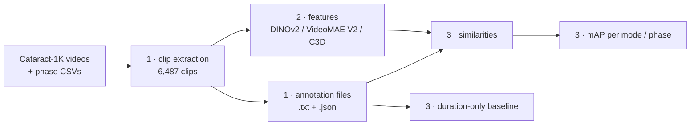

# SurgCBVR-CAT

Code for building, encoding and evaluating **SurgCBVR-CAT**, a benchmark for content-based retrieval of cataract surgery video clips. Given a clip, the task is to retrieve clips of the same **surgical phase from other patients' operations** (surgical phase video retrieval, SPVR).

- **Dataset (clips + annotations):** TODO: Hugging Face URL
- **Paper:** TODO: Data in Brief citation and DOI

> **Only want to evaluate your own method?** Download the dataset from Hugging Face, compute one feature vector per clip, and go to [step 3](#3-evaluation). Steps 1 and 2 regenerate the clips and the baseline features.

## Pipeline

The scripts in each folder are numbered in the order they are run.

```
1_DatasetCreation_Cataract1K/     Cataract-1K videos + phase annotations -> clips + annotation files
2_FeatureExtraction/              clips -> one feature matrix per encoder
3_Evaluation/                     feature matrix -> similarities -> mAP tables
```



## Requirements

- Python ≥ 3.10
- `ffmpeg` and `ffprobe` on the `PATH`
- Python packages:

```bash
pip install numpy pandas tqdm opencv-python pillow torch timm
```

Encoder weights, needed only for step 2:

| Encoder | What to download |
|---|---|
| DINOv2 ViT-B/14 | downloaded automatically by `timm` (`vit_base_patch14_dinov2.lvd142m`) |
| VideoMAE V2 ViT-B | alredy cloned [OpenGVLab/VideoMAEv2](https://github.com/OpenGVLab/VideoMAEv2). But download [`vit_b_k710_dl_from_giant.pth`](https://huggingface.co/OpenGVLab/VideoMAE2/resolve/main/distill/vit_b_k710_dl_from_giant.pth) and put it in VideoMAEv2-master folder|
|C3D (Sports-1M)  |  already cloned, but downlonad `c3d.pickle` [DavideA/c3d-pytorch](https://github.com/DavideA/c3d-pytorch), and put it in c3d-pytorch-master folder  |

Each script has a **CONFIG** block at the top with input and output paths. Edit it before running.

## 1. Dataset creation

`1_DatasetCreation_Cataract1K/` 

Scripts are numbered sequantially and follow them if you want to recreate the dataset. However dataset is already available on huggingface.

**Input:** the Cataract-1K phase-recognition release, i.e. videos as `case_<id>.mp4` and annotations as `case_<id>/case_<id>_annotations_phases.csv`. The data structure of the input videos and phase labels for two videos from Cataract-1K dataset is shown as example in Phase_recognition_dataset_224_short folder. 
For complete version, download **Source videos:** [Cataract-1K](https://doi.org/10.1038/s41597-024-03193-4), 56 phase-annotated phacoemulsification videos, resize them to 224x224 with zero padding (make them square size) and follow the data formatn in Input. 


**Sampling**
- Clips are placed around the centre of each phase at offsets of −20%, −10%, 0, +10% and +20% of the phase duration, and are kept inside the phase.
- **Modes:** fixed 5 s, fixed 10 s, proportional (⌊duration/5⌋ s) and playback speed 2×/3×/5× (centre clip only, output 5 s).
- Idle segments are excluded.
- Every clip contains a single annotated phase.

**Clip names:** `<case>_<phase>_<fixed|prop><L>s_offset<o>_<t>.mp4` or `<case>_<phase>_speed<s>_offset0_<t>.mp4`. The phase may contain underscores; the dataset card gives the exact pattern.

## 2. Feature extraction

`2_FeatureExtraction/` TODO: check the filenames.

| Script | Encoder | Feature |
|---|---|---|
| `1_extract_dinov2.py` | DINOv2 ViT-B/14 (LVD-142M) | CLS token per frame, mean **or** max over frames (set `AGGREGATION`), 768-d |
| `2_extract_videomaev2.py` | VideoMAE V2 ViT-B (distilled, Kinetics-710) | last-layer tokens, mean **and** max, 768-d |
| `3_extract_c3d.py` | C3D (Sports-1M) | fc7 per 16-frame window, mean **and** max over windows, 4,096-d |
| `feature_checkpoint.py` | helper | crash-safe writing and resuming (imported by the scripts above) |

| | DINOv2 | VideoMAE V2 | C3D |
|---|---|---|---|
| Input | 224×224, every 5th frame (≈12 fps), ≤ 150 frames spread over the clip | 16 frames × stride 8 (≈ 2.1 s), 224×224, ImageNet mean/std | 16 frames × stride 2 (≈ 0.5 s), resize 128 → crop 112, RGB 0–255 |
| Coverage | whole clip | ⌈frames/128⌉ windows spread over the clip (≤ 16) | non-overlapping windows (≤ 32) |

All encoders are frozen, and every clip vector is L2-normalised. Strides are set for the clips' 59.94 fps, so that the temporal span matches each model's pretraining.

**Output:** per encoder and pooling, one matrix `video_features_<encoder>_<pooling>.npy` (float32, N × D), a `_config.json` with all hyperparameters, and a resume journal (`.progress.sqlite3`).

- **Row *i* is the clip on line *i* of `annotations_CBVR_CAT.txt`.** Clip names are not stored in the matrix, so keep this list with it.
- **Resuming:** if a run is interrupted, run the same command again and it resumes. It refuses to resume if the settings or the clip list have changed.
- **Parallel runs:** the three encoders can run at the same time, e.g. one per GPU with `CUDA_VISIBLE_DEVICES`. Never run two copies of the same script on the same output.

## 3. Evaluation

`3_Evaluation/`

| Script | Does |
|---|---|
| `1_calculate_similarities.py` | Cosine similarity between every query and every clip; saves a FIVR-style JSON and, optionally, the `.npy` matrix |
| `2_evaluate_map.py` | Applies the protocol and reports mAP per mode, per phase × mode and class-averaged; saves per-query and summary CSVs |
| `3_duration_only_baseline.py` | Ranks by clip length alone, as a reference for the proportional mode (mean ± SD over 20 random tie-breaks) |

**Protocol**, implemented in `2_evaluate_map.py`:
- **Gallery:** for each query, all clips **except** the query itself, clips from the **same surgery** (`EXCLUDE_SAME_CASE = True`) and clips of **another mode** (`GALLERY = "same_mode"`).
- **Positives:** clips of the same phase from other surgeries, restricted to that gallery.
- **AP:** computed over the filtered ranking. Queries with no positive in their gallery are skipped and counted.
- **"All":** the mean of all per-query APs, each computed in its own mode's gallery.

**Settings**

| Setting | Default | Alternative |
|---|---|---|
| `GALLERY` | `"same_mode"`: one result per mode | `"all"`: one mixed gallery |
| `SPEED_GALLERY` | `"same"`: speed-*s* queries vs speed-*s* clips | `"fixed5s"`: speed queries vs normal-speed 5 s clips (robustness) |

Run `1_calculate_similarities.py` with `EXCLUDE_SAME_CASE = False` and `SAME_MODE_GALLERY = False`, so that all gallery rules are applied only in `2_evaluate_map.py`.

**Evaluating your own method**
1. Produce a float32 `.npy` matrix with one row per line of `annotations_CBVR_CAT.txt`, in the same order.
2. Point `feature_file` in `1_calculate_similarities.py` to it and run it.
3. Run `2_evaluate_map.py` on the result.

Methods that produce similarities directly can write the JSON `{query: {clip: score}}` and skip step 2.

## Reproducing the paper's table

```bash
cd 2_FeatureExtraction && python 1_extract_dinov2.py      # once with AGGREGATION="mean", once with "max"
python 2_extract_videomaev2.py && python 3_extract_c3d.py
cd ../3_Evaluation
python 1_calculate_similarities.py     # once per feature file
python 2_evaluate_map.py               # once per similarity file
python 3_duration_only_baseline.py
```


## Citation

```bibtex
@article{TODO_surgcbvrcat,
  title   = {TODO},
  author  = {TODO},
  journal = {Data in Brief},
  year    = {TODO},
  doi     = {TODO}
}
```

Please also cite [Cataract-1K](https://doi.org/10.1038/s41597-024-03193-4) and the encoders you use.

